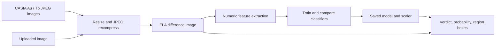
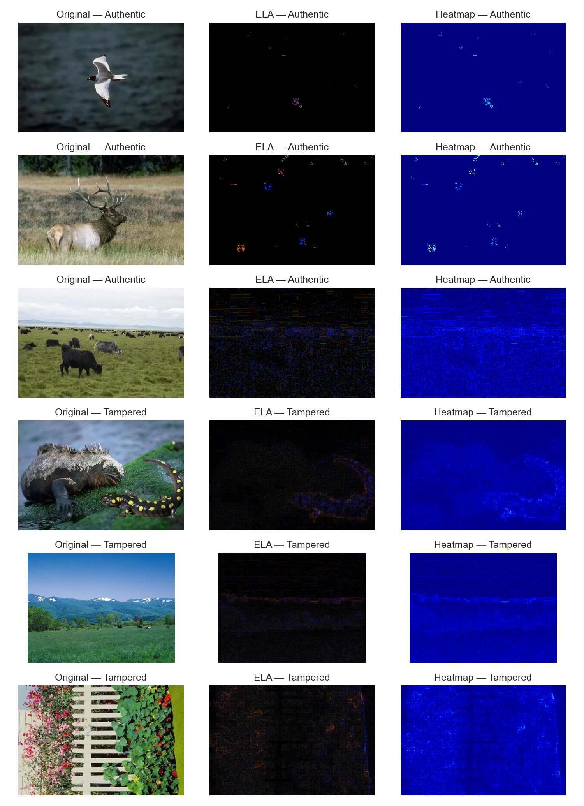
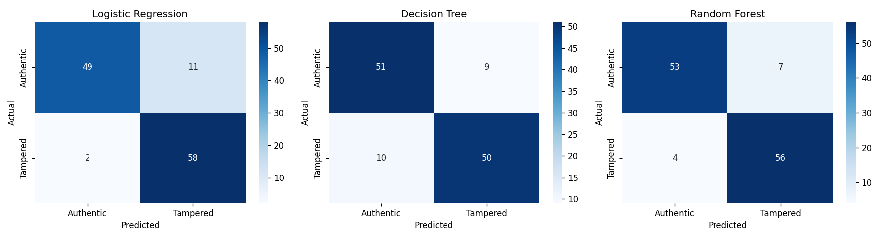
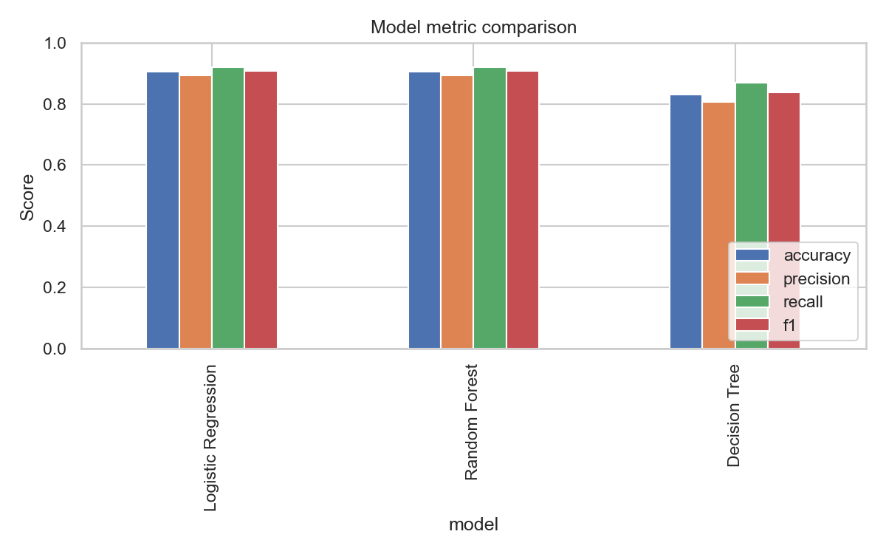
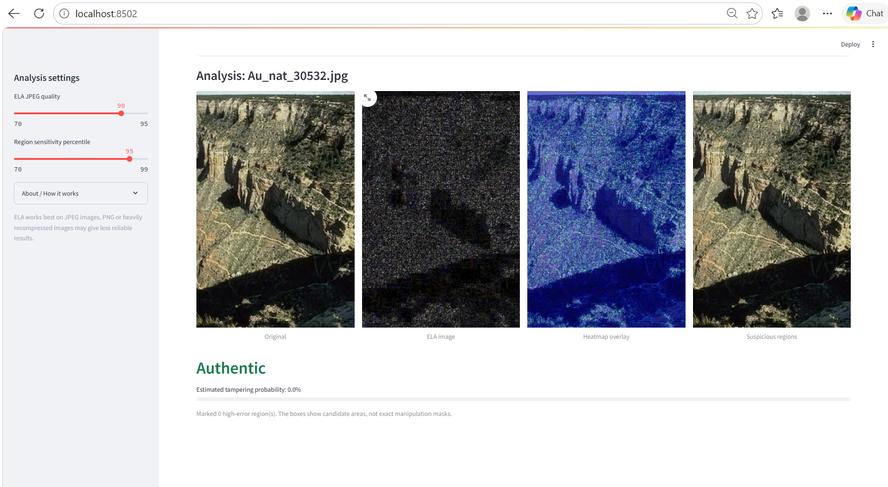
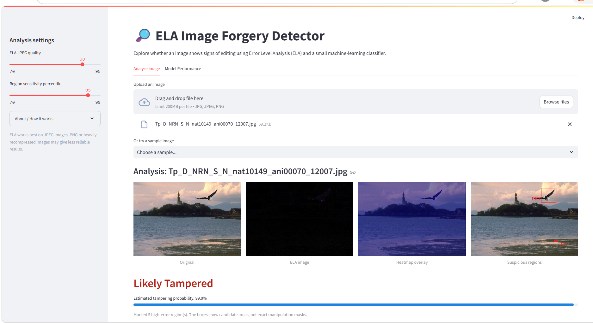

# ELA Image Forgery Detector

A CPU-friendly project that uses Error Level Analysis (ELA) and classical machine learning to flag images that may have been manipulated. Built for the REVA University Abhinava Hackathon (Problem Statement 7: Image Tampering Detection). It is an educational demo, not forensic proof.

## Problem statement

Copy-paste edits, splicing, and retouching can leave image regions with compression patterns that differ from the rest of a JPEG. This project turns those ELA patterns into numeric features and trains a classifier to distinguish authentic images from tampered ones. For any uploaded image it shows a verdict, a tampering probability, an ELA heatmap, and boxes around the most suspicious regions.

## Approach

1. Re-save each JPEG at a fixed quality and subtract it from the original to get an ELA map.
2. Extract numeric features from the ELA map (channel statistics, percentiles, histogram, an 8x8 block grid, edge density).
3. Train Logistic Regression, Decision Tree, and Random Forest classifiers, and keep the best by F1-score.
4. For a new image, output a verdict, probability, ELA heatmap, and suspicious-region boxes.

## How ELA works

1. The image is saved again as a JPEG at a chosen quality.
2. The recompressed version is compared pixel by pixel with the input.
3. Differences are amplified: brighter pixels changed more during recompression.
4. Edited regions can have a different compression history and may stand out.

ELA is a visual clue. Resizing, repeated saves, image format, and camera processing can also change compression error.

## Pipeline



## Project structure

```text
Image-Tampering-Detection/
├── app.py                # Streamlit demo
├── train.py              # Feature building, training, comparison, plots
├── predict.py            # Command-line prediction
├── src/                  # ELA, features, dataset, prediction, shared helpers
├── data/raw/Au/          # Authentic images (label 0)
├── data/raw/Tp/          # Tampered images (label 1)
├── models/               # Trained model, scaler, feature names
├── outputs/              # Metrics, plots, predictions
├── samples/              # Demo images for judges
├── tests/                # pytest tests
├── notebooks/            # Colab notebook (independent run of the same method)
└── requirements.txt
```

## Tech stack

Python 3.10+, Pillow, OpenCV, NumPy, pandas, scikit-learn, matplotlib, seaborn, joblib, Streamlit, tqdm, and pytest. Dependencies are pinned in `requirements.txt`.

## Dataset

We used the [CASIA 2.0 Image Tampering Detection Dataset](https://www.kaggle.com/datasets/divg07/casia-20-image-tampering-detection-dataset) from Kaggle. Images are arranged as `data/raw/Au/` (authentic) and `data/raw/Tp/` (tampered).

- Only **JPEG** files were used from both classes. In CASIA v2 many tampered images are TIFF, so using every file would let a model learn the file format instead of the forgery.
- The subset is balanced: **500 authentic + 500 tampered** images.
- Dataset access and redistribution terms are set by the dataset provider. The raw images are not included in this repository.

## Setup

Use Python 3.10 or newer. From the project directory:

```bash
python -m venv .venv
# Windows PowerShell
.venv\Scripts\Activate.ps1
# macOS/Linux: source .venv/bin/activate
python -m pip install -r requirements.txt
```

## Train the classifiers

With the JPEG subset placed in `data/raw/Au` and `data/raw/Tp`:

```bash
python train.py --limit 500
```

Features are cached in `data/features.csv`; use `--force-features` to recompute them. Training uses an 80/20 stratified split with random seed 42 and selects the model with the highest F1-score.

Training creates:

- `models/best_model.joblib`, `models/scaler.joblib`, `models/feature_names.joblib`
- `outputs/model_comparison.csv` and `outputs/accuracy_comparison.png`
- Confusion matrices for each classifier, `outputs/roc_curve.png`, `outputs/feature_importance.png`, and `outputs/ela_samples.png`

## Run the demo

```bash
streamlit run app.py
```

Upload a JPG/JPEG/PNG, or choose an example from `samples/`. The app shows the original image, the ELA image, a heatmap overlay, and an annotated image with suspicious regions boxed, plus a verdict and tampering probability. A second tab shows model performance. If the model files are missing, the app tells you to train first.

For a command-line prediction:

```bash
python predict.py path/to/image.jpg
```

## Results

Evaluated on a balanced, JPEG-only subset of CASIA v2 (500 authentic + 500 tampered images, stratified 80/20 split, 200 test images).

| Model | Accuracy | Precision | Recall | F1 |
|---|---|---|---|---|
| Logistic Regression | 0.905 | 0.893 | 0.920 | 0.906 |
| Random Forest | 0.905 | 0.893 | 0.920 | 0.906 |
| Decision Tree | 0.830 | 0.806 | 0.870 | 0.837 |

**Saved model:** Logistic Regression. It tied with Random Forest on F1, so the simpler model was kept.

Full metrics are in `outputs/model_comparison.csv`. Plots in `outputs/`: accuracy comparison, confusion matrices, ROC curve, feature importance, and ELA samples.

An independent Colab run of the same method (`notebooks/casia_v2_ela_tampering_detection.ipynb`, 300 images per class, 120 test images) gave Random Forest F1 = 0.911 and Logistic Regression F1 = 0.899. The table above is from the local `train.py` run used by the app.

**Caveats:** Results apply to CASIA v2 JPEGs and may not generalize to other datasets. Related authentic/tampered images can appear across the train/test split and may slightly inflate scores. The test set is small (200 images), so scores can shift by a few points between runs.

## Screenshots











## Tests

```bash
pytest tests
```

Error analysis by source group: `python check_bias.py` (5-fold cross-validated accuracy and per-group false-positive rates).

## Limitations

- ELA is most useful for JPEGs and can be unreliable for PNGs, repeatedly recompressed images, resized images, screenshots, or uniformly processed images.
- High ELA values are not uniquely caused by tampering; texture, edges, and camera processing can also create them.
- In the separate Colab run, overall ELA intensity (a raw maximum-difference feature) was the most important Random Forest feature, which points the same way: some of the signal may come from compression differences between image groups. The local model does not use that feature.
- A feature-based model trained on CASIA may not generalize to other cameras, editing tools, or image sources. The probability is a model score, not a calibrated forensic certainty.
- The bounding boxes mark high-error connected regions; they are not pixel-accurate manipulation masks.
- Metrics from the optional synthetic smoke-test data (`train.py --synthetic-demo`) are not meaningful and must not be reported as real results.
- Cross-validated accuracy is 88.1% (5-fold), close to the 90.5% held-out score. However, an error analysis by CASIA source group (`check_bias.py`) shows that authentic images numbered 1xxxx and 2xxxx are wrongly flagged as tampered about 83-84% of the time, versus about 4.5% for the 3xxxx group. The classifier therefore partly learns source or compression differences between image groups, not only local edits. A source-balanced or group-aware split is the next step.

## Future scope

- Train a CNN directly on ELA images and compare it with the feature baseline.
- Add noise-residual analysis and copy-move detection using SIFT.
- Produce pixel-level localization masks and evaluate localization quality.
- Test on independent datasets and report confidence intervals.
- Use a source-balanced, group-aware train/test split so that images from the same source never appear on both sides, and re-measure accuracy.

## Team details

Team name: TraceBack

| Member | Name | SRN | Role |
|---|---|---|---|
| Member 1 | Madhushree | R25EJ062 | ELA and image preprocessing |
| Member 2 | Nishitha C | R25EJ089  | Features and dataset pipeline |
| Member 3 | Pooja Utagi | R25EJ099  | Model training and evaluation |
| Member 4 | Poonam Kumari | R25EJ100  | Streamlit demo, testing, and presentation |

Each member owns one role above; the complete demo and results were reviewed together before presenting.
